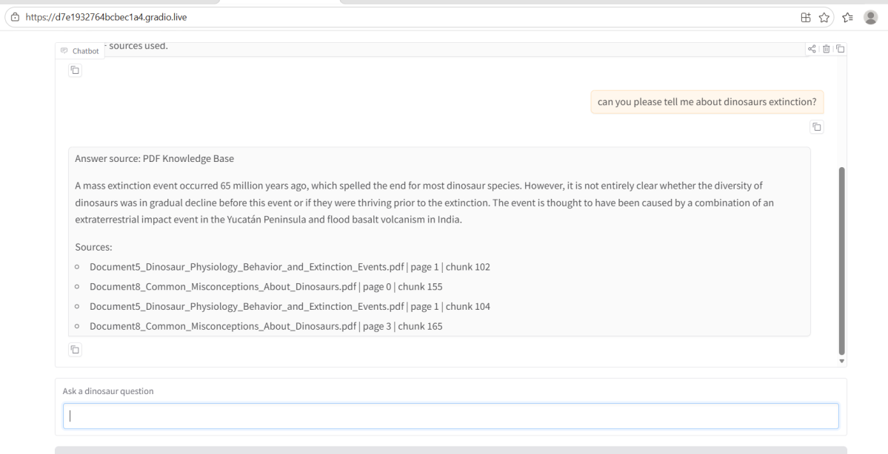
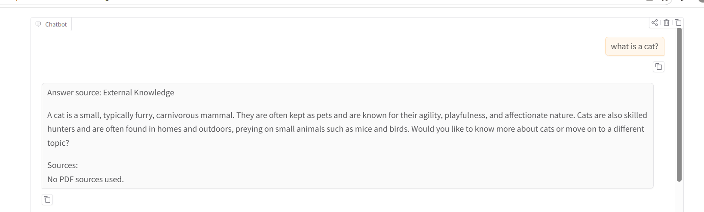
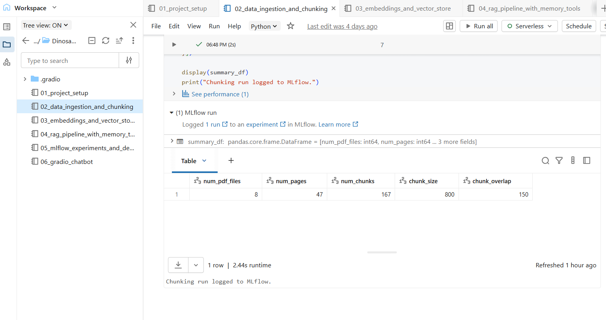

# DinoRAG: Domain-Specific RAG Chatbot

A retrieval-augmented generation (RAG) chatbot that answers dinosaur questions from a private PDF knowledge base, cites the source file, page and chunk for every grounded answer, and falls back to the LLM's general knowledge, clearly labelled, when retrieval is weak. It's built on **Databricks** with **LangChain**, **FAISS**, **Sentence-Transformers**, a **Databricks-hosted Llama 3.1 8B** chat endpoint, **MLflow** tracking and a **Gradio** UI.

Team project · Lambton College AI & ML program · 2026 · Narinder Kaur and Diksha Sharma



## How it works

```
8 dinosaur PDFs (Unity Catalog volume)
        │  PyPDFLoader → 47 pages
        ▼
RecursiveCharacterTextSplitter (800 chars, 150 overlap) → 167 chunks
        │                                   └──► Delta table main.default.dinosaur_chunks
        ▼
all-MiniLM-L6-v2 embeddings ──► FAISS IndexFlatL2 (saved to the volume)
        │
        ▼  user question
similarity_search_with_score (top-k = 4)
        │
        ├── strong context?  (≥ 2 docs, ≥ 300 chars, avg L2 distance ≤ 1.6)
        │        yes ──► PDF-grounded prompt ──► answer + sources
        │        no  ──► general-knowledge prompt ──► answer labelled "External Knowledge"
        ▼
Llama 3.1 8B Instruct (databricks-meta-llama-3-1-8b-instruct, temperature 0.1)
        │
        ▼
Gradio chat UI · last 3 turns kept as conversation memory · runs and traces logged to MLflow
```

**Grounded answers.** The PDF prompt tells the model to answer only from the retrieved context and to reply *"I could not find enough information in the PDF knowledge base"* when the context doesn't support an answer, rather than guessing.

**Transparent fallback.** Every reply starts with its source (`Answer source: PDF Knowledge Base` or `Answer source: External Knowledge`), and grounded replies list the file, page and chunk they used.



## Notebooks

| # | Notebook | What it does |
|---|----------|--------------|
| 01 | `01_project_setup.ipynb` | Creates the volume folders, writes `project_config.json` (paths, chunking, model and endpoint names), logs a setup run to MLflow |
| 02 | `02_data_ingestion_and_chunking.ipynb` | Loads the 8 PDFs, chunks them, attaches source / page / chunk-id metadata, saves the chunks to a Delta table and logs chunking parameters |
| 03 | `03_embeddings_and_vector_store.ipynb` | Embeds the chunks with all-MiniLM-L6-v2, builds and saves the FAISS index, tests retrieval |
| 04 | `04_rag_pipeline_with_memory_tools.ipynb` | Retrieval with scores, the strong-context check, PDF and fallback prompts, conversation memory, source-lookup and SQL period-lookup tools, MLflow LangChain autologging |
| 05 | `05_mlflow_experiments_and_demo.ipynb` | Runs an evaluation question set at top-k = 3, 4 and 5, logs latency, answer length and PDF-vs-fallback counts to MLflow, saves `eval_results.csv` |
| 06 | `06_gradio_chatbot.ipynb` | The Gradio chat app with a clear-chat button and shareable link |

Every notebook reads its settings from one config file, so chunk size, top-k, the embedding model or the chat endpoint can be changed in one place.

## Data and settings

| Setting | Value |
|---------|-------|
| Documents | 8 PDFs (classification, discovery history, size and behaviour, communication, reproduction, physiology, extinction, misconceptions) |
| Pages / chunks | 47 / 167 |
| Chunk size / overlap | 800 / 150 characters |
| Embeddings | `sentence-transformers/all-MiniLM-L6-v2` (384-d) |
| Vector store | FAISS, exact L2 search |
| Retrieval | top-k = 4 (3 and 5 also evaluated) |
| LLM | `databricks-meta-llama-3-1-8b-instruct`, temperature 0.1, max 500 tokens |
| Tracking | MLflow experiment `/Shared/Dinosaur_RAG_Experiments` |



## Example behaviour

| Question | Route | Result |
|----------|-------|--------|
| "Can you please tell me about dinosaurs' extinction?" | PDF | Answer on the end-Cretaceous extinction (impact plus Deccan volcanism) with 4 cited chunks |
| "What did Stegosaurus eat?" | PDF | Refuses: the PDFs don't cover it, so the model says it couldn't find enough information instead of inventing an answer |
| "What is a cat?" | External | Answers from general knowledge and labels the reply "External Knowledge", with no PDF sources |

## Run it

1. In Databricks, upload the PDFs to a Unity Catalog volume (`/Volumes/main/default/dino_pdfs` by default).
2. Run notebooks `01` to `06` in order. Each one starts with its own `%pip install` cell.
3. Notebook `06` launches the Gradio app and prints a public share link.

You'll need access to a Databricks model-serving chat endpoint. Change `chat_endpoint` in `01_project_setup.ipynb` to use a different one.

## Limitations and next steps

- **Fallback threshold tuning.** In our tests, L2 distances for dinosaur-related questions were about 0.8–1.25, well under the 1.6 cut-off, so on-topic questions the PDFs can't answer (such as "Which dinosaur lived on Mars?") stay on the PDF route and get the refusal message. A lower threshold, chosen from a labelled question set, would send more of them to the fallback.
- **Retrieval quality.** A small general-purpose embedding model sometimes ranks loosely related chunks first. Next steps are a re-ranker, hybrid BM25 + vector search, or a larger embedding model.
- **Evaluation.** The current metrics are latency, answer length and route counts. Adding faithfulness and answer-relevance scoring (for example with `mlflow.evaluate` and an LLM judge) would measure answer quality directly.
- **Deployment.** The Gradio share link lasts a week. The app could be hosted permanently on Hugging Face Spaces or Databricks Apps.

## Tech stack

Python · Databricks · LangChain · FAISS · Sentence-Transformers · Llama 3.1 (Databricks Model Serving) · MLflow · Gradio · Delta Lake · Spark SQL
